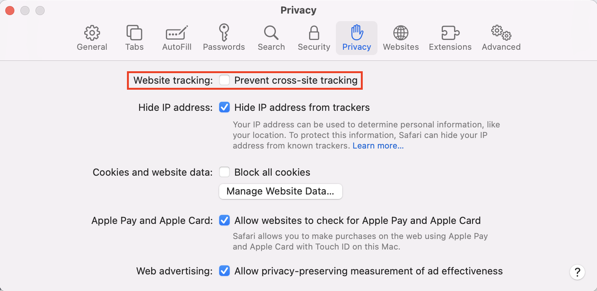
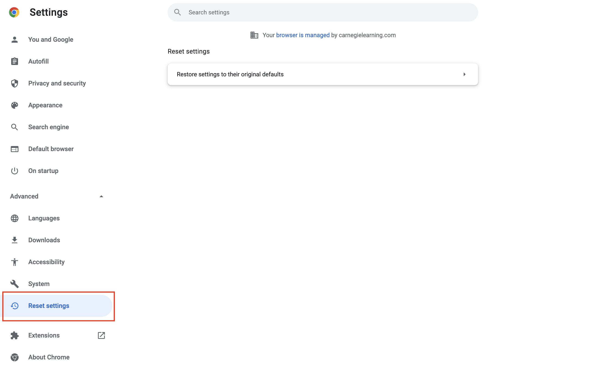

# Opening a new tab in UpGrade prompts for re-authorization

## Problem

Opening a new tab in UpGrade prompts for re-authorization

## Solution

In Safari, the default privacy option is to prevent cross-site tracking. This also prevents UpGrade from retaining your session between tabs. Disable the cross-site tracking option by opening your Safari _Preferences_, navigating to _Privacy,_ and un-checking the _Website tracking_ checkbox. Now you should be able to open experiments in new tabs and remained logged in.\
\
If you're using another browser, try resetting your browser's cookie settings and checking that your browser is up-to-date. Firefox and Chrome's default settings should let you retain sessions across tabs. You may also be in Incognito Mode which has additional cookie blocking settings.

