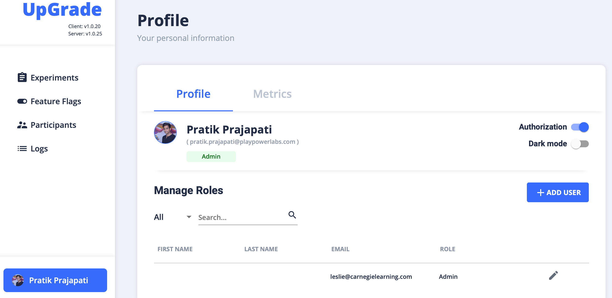

# Token is not present in the request header

## Problem

`info: [api:middlewares/ErrorHandlerMiddleware]`

`Insert Error in database {"0":{}}`

`info: [api:services/ErrorService] Inserting an error =>`

`{"name":"Error","message":"Provided token is invalid","endPoint":"/api/assign","type":"Invalid token"}`

## Solution

Disable the Authorization toggle from UI to disable auth on client-side SDK

