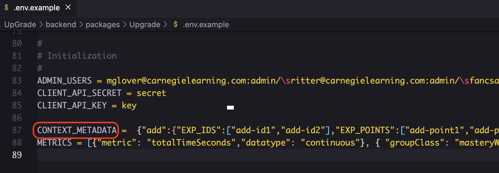

# Context Metadata

<figure><figcaption></figcaption></figure>

**What is this Context Metadata thing?**\
\
Like [**METRICS**](metrics.md), the **CONTEXT\_METADATA** env var is nothing more than a JSON dictionary of client-defined identifiers to be used to keep the client app state in sync with UpGrade. It will represent a contract of agreed-upon technical terms between the Client app, UpGrade, and users creating/tracking experiments.\
\
You must have at least 1 **CONTEXT\_METADATA** JSON object described in your `.env` file in order for backend to compile. There's an example in `.env.example` of one you can start with, but you will want to edit it once you are up and running. [See also Environment Variables.](environment-variables/)\
\
Most of these terms are not required, but the object itself is. The benefit will be to help keep UpGrade in sync with identifiers that _should_ be valid for an experiment. The other strong benefit to keeping this metadata up-to-date is for UI autocomplete (see below for examples).


In future UpGrade releases, this context-metadata object will accommodate different app-versions per Client context, as well an API to manage this data instead of an Environment Variable. For now, a context is limited to representing client app state broadly, and must be defined in your backend configuration.



Even if keeping metadata current is not necessary for you application, you will need to at least have a boilerplate ContextMetadata object defined with your application's unique identifier as the root-level key. This key is important as it will be your application's "**app-context**", which will be used to partition your experiment's data and route its requests.


\
**What exactly can I define?**\
\
The context metadata object is defined in the [Environment Variables](environment-variables/) and will describe:

1. An identifier for your app "**app\_context**" (required).
2. A set of valid strings to identify names of "**GROUP\_TYPES**" of users within your context (if using groups).
3. A set of valid strings to identify places in codebase where your experiment conditions will be delivered (**"Decision Points"**).\
   \
   **Decision Points** are a composite id of two identifiers, **Site** + **Target**:\
   \- "**Sites**" (also known as "**EXP\_POINTS**"), e.g. a module or other broad codebase identifier\
   \- "**Targets**" (also known as "**EXP\_IDS**"), e.g. a specific point in code
4. A set of valid strings to identify the "**CONDITIONS**" expected by your codebase.

\
This must be valid JSON, but it may be easier to describe as a Typescript Type interface:

```typescript
interface ContextMetadata {
  /**
   * ContextMetadata is a JSON dictionary of Contexts.
   * The key(s) is user-defined, such as the name of your application.
   * This key will be known as "app-context" within UpGrade.
   * It is required for tying your API/Client Library requests to your application
   */
  { key: string }: ContextMetadataDetails
}

interface ContextMetadataDetails {
  /**
   * Client-defined identifiers to be used to create a contract of agreed-upon
   * terms between the Client app, UpGrade, and users creating/tracking experiments.
   */
  "EXP_POINTS": string[];
  "EXP_IDS": string[];
  "GROUP_TYPES": string[];
  "CONDITIONS": string[];
}
```

\
So an example in your `.env` files might contain some like this:

```json
CONTEXT_METADATA =
{
    "YourApp": {
        "EXP_POINTS":["DashboardModule", "SignupModule"],
        "EXP_IDS":["SignupStep1","SignupStep2"],
        "GROUP_TYPES":["Friends","Acquaintences","WellWishers"],
        "CONDITIONS":["control","variant1","variant2"]
    }
}
```

**Where will I see these values get used?**\
\
In UpGrade UI, you will see all of these values pop up as you create a new experiment:\
<br>

<figure><figcaption><p>"App-Context" is required for a new experiment<br><br></p></figcaption></figure>

<figure><figcaption></figcaption></figure>

<figure><figcaption></figcaption></figure>

<figure><figcaption><p>GROUP_TYPES</p></figcaption></figure>

<figure><figcaption><p>EXP_POINTS</p></figcaption></figure>

<figure><figcaption><p>EXP_IDS</p></figcaption></figure>

<figure><figcaption><p>CONDITIONS</p></figcaption></figure>
