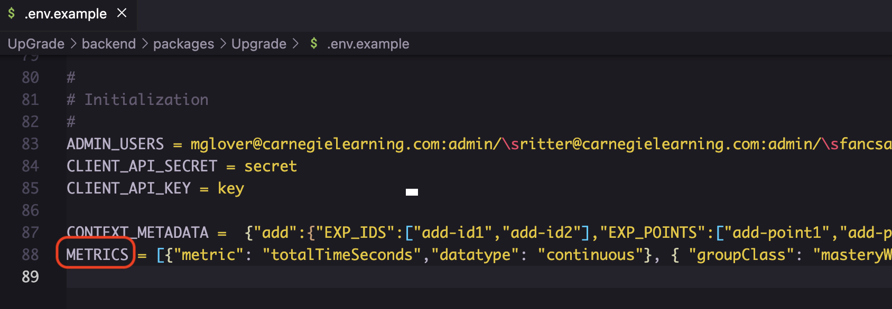

# Metrics

<figure><figcaption></figcaption></figure>

**Metric Types**

There are two types of metrics available for collection in UpGrade - Simple metrics and Repeated/Grouped metrics. Simple metrics are collected and overwritten every time new data is available. Simple metrics are used for things like the total time spent in the educational app, or the number of login sessions. Previous values are irrelevant and are not kept. Repeated metrics are the opposite - each logged metric is saved and UpGrade can perform simple statistics on the collection. Repeated metrics are used for things like quizzes that allow multiple attempts or other repeated, measurable tasks. Repeated (or Grouped) metrics are defined by a class and a key. The class could be "Quizzes" and repeated metrics under that class could be the score and pass/fail status of "Quiz 1", "Quiz 2", and "Quiz 3". Your application does not have to allow students to attempt the Repeated metric multiple times. It can also be used to group related metrics.

Within these two types of metrics, metrics can be categorical or continuous. Continuous metrics are numerical and can take on any number value. Categorical metrics have discrete, separate groups and the groups must be defined in the environment variable. Metrics can also be defined using the add-metrics editor found under "Profile" in the UI, or programmatically via the [`/metric` POST API](api-documentation.md#metric). \
\
**UI:**

<figure><figcaption></figcaption></figure>

**Example**

Let's say in your educational application, you have three quizzes ("Quiz 1", "Quiz 2", and "Quiz 3") which users are allowed to take multiple times. You also have two polls ("Poll 1", "Poll 2"), which can only be attempted once. You want to record the total time a student spends in your application, whether the a student has completed all activities, the score, time spent, and pass/fail status of each quiz, and the time spent and result from each poll. You might define your **METRICS** as:

<pre class="language-json" data-overflow="wrap"><code class="lang-json">[
    {"metrics":
        [
            {
                "metric": "totalTimeSeconds",
                "datatype": "continuous"
            },
            {
                "metric": "completedAll",
                "datatype": "categorical",
                "allowedValues": [ "COMPLETE", "INCOMPLETE" ]
            },
            {
                "groupClass": "quizzes",
                "allowedKeys":
                    [
<strong>                        "quiz1",
</strong><strong>                        "quiz2",
</strong><strong>                        "quiz3"
</strong><strong>                    ],
</strong><strong>                "attributes": 
</strong><strong>                    [
</strong><strong>                        {
</strong><strong>                            "metric": "quizTimeSeconds",
</strong><strong>                            "datatype": "continuous"
</strong><strong>                        },
</strong><strong>                        {
</strong>                            "metric": "score",
                            "datatype": "continuous"
                        },
                        {
                            "metric": "passStatus",
                            "datatype": "categorical",
                            "allowedValues": [ "PASS", "FAIL" ]
                        }
<strong>                    ]
</strong><strong>            },
</strong><strong>            {
</strong>                "groupClass": "polls",
                "allowedKeys":
                    [
                        "poll1",
                        "poll2"
                    ],
                "attributes": 
                    [
                        {
                            "metric": "pollTimeSeconds",
                            "datatype": "continuous"
                        },
                        {
                            "metric": "rank",
                            "datatype": "categorical",
                            "allowedValues": [ "UNHAPPY", "NEUTRAL", "HAPPY" ]
                        }
                    ]
            }
<strong>        ],
</strong><strong>        "contexts": ["add", "sub"]
</strong><strong>    }
</strong><strong>]
</strong></code></pre>

Note that METRICS is a list of metrics arrays and their associated contexts. The above example defines a single list of metrics for that will be available in the "add" and "sub" contexts.

We have two simple metrics, where previous values don't matter. Once a student has logged 60 seconds in the application, it doesn't matter that the student had previously logged 10 seconds. Time in seconds is a continuous metric while completion status is a categorical metric. We also have two Repeated/Grouped metrics. The quizzes have two continuous metrics, score and time, and one categorical metric, the pass/fail status. The polls have one continuous metric, the time in seconds, and one categorical metric, their response to the poll. Even though the polls can only be attempted once in the application, we grouped them together since we're collecting the same kind of data from each one, rather than have a simple metric for Poll 1's time, Poll 1's rank result, Poll 2's time, and Poll 2's rank result.

**Metrics in an Experiment**

Once you've defined the metrics you'll be collecting, you can attach metrics to an experiment. The metrics defined in **METRICS** are now available in the Experiment creation stepper.&#x20;


UpGrade will NOT save any logged metrics UNLESS they are attached to an experiment!


When selecting a continuous simple metric, you choose the statistical operation (defined in `OPERATION_TYPES` enum below) and a display name.

<div><figure><figcaption><p>Options when selecting a continuous metric</p></figcaption></figure> <figure><figcaption><p>Completed continuous metric</p></figcaption></figure></div>

When selecting a categorical simple metric, you choose the statistic (count or percentage), the comparison (equal or not equal), and the value itself. In the screenshot, we're measuring the count of "COMPLETE" statuses.

<div><figure><figcaption><p>Options when selecting a categorical metric</p></figcaption></figure> <figure><figcaption><p>Completed categorical metric</p></figcaption></figure></div>


Simple metrics are not available for within-subjects unit of assignment.


When selecting a repeated metric, you first select the group class, then group key, then the metric. From there, the options are the same as a simple metric, except that you also can choose which of the repeated metrics you want to use. You can select "Earliest" for the first record, "Most Recent" for the latest record, or "Mean" for the average of all the saved records.

In the screenshots below, we're collecting the average first score on Quiz 2 and the average latest score on Quiz 2. We're also measuring the percentage of users that most recently voted "Happy" in Poll 1.

<div><figure><figcaption><p>Options when selecting a repeated metric</p></figcaption></figure> <figure><figcaption><p>Completed repeated metrics</p></figcaption></figure></div>

In the code block below, you can see the supported operations, metric types, and repeated measure calculations. These are defined in [`upgrade_types`](https://github.com/CarnegieLearningWeb/UpGrade/tree/dev/types)`.`

```typescript
export enum OPERATION_TYPES {
  SUM = 'sum',
  COUNT = 'count',
  MIN = 'min',
  MAX = 'max',
  AVERAGE = 'avg',
  MODE = 'mode',
  MEDIAN = 'median',
  STDEV = 'stddev',
  PERCENTAGE = 'percentage',
}

export enum IMetricMetaData {
  CONTINUOUS = 'continuous',
  CATEGORICAL = 'categorical',
}

export enum REPEATED_MEASURE {
  mean = 'MEAN',
  earliest = 'EARLIEST',
  mostRecent = 'MOST RECENT',
}
```

\
**Logging Metrics**

You can find the specifications for the [`/log`](api-documentation.md#log) POST API in the Client SDK section. One important note is that UpGrade tries to be _smart_ about its data collection. Your application can continually pipe over log message after log message. UpGrade will only pick out the important pieces of information. "Important" information is metric values defined in METRICS that are attached to an experiment. Before the metrics are attached, UpGrade will toss all data.

<figure><figcaption><p>Metrics attached to an experiment</p></figcaption></figure>

For example, if an application user does some activity in your application and sends a log message to UpGrade before any metrics are attached to an experiment, the `/log` request returns an empty array. Now create the experiment above that's monitoring the total time in seconds, completion status, Quiz 2 score, and Poll 1 rank. Set the experiment to enrolling. Send a /log request with the following body:

````
{
    "userId": "user",
    "value": [
        {
            "userId": "user",
            "timestamp": "2022-12-20T15:19:01.977Z",
            "metrics": {
                "attributes": {
                    "totalTimeSeconds": 20,
                    "completedAll": "INCOMPLETE",
                    "uncapturedMetric": 15
                },
                "groupedMetrics": [
                    {
                        "groupClass": "quizzes",
                        "groupKey": "quiz2",
                        "groupUniquifier": "2022-12-20T15:19:01.977Z",
                        "attributes": {
                            "timeSeconds": 20,
                            "score": 50,
                            "passStatus": "FAIL"
                        }
                    },
                        {
                            "groupClass": "polls",
                            "groupKey": "poll1",
                            "groupUniquifier": "2022-12-20T15:19:01.977Z",
                            "attributes": {
                                "timeSeconds": 20,
                                "rank": "NEUTRAL"
                            }
                        }
                    ]
                }
            }
        ]
    }
```
````


UpGrade will still capture metrics attached to an inactive experiment, but won't calculate with them until a user is assigned a condition and has marked the experiment point. See ClientSDK for more information on assign and mark.


The request responds as below, noting that the only metrics that have been saved are the ones attached to the experiment. The `uncapturedMetric` is discarded, as is Quiz 2's time and pass status as well as Poll 1's time.

```
[
    [
        {
            "createdAt": "2023-03-24T15:18:04.608Z",
            "updatedAt": "2023-03-24T15:19:20.541Z",
            "versionNumber": 3,
            "id": 3,
            "uniquifier": "1",
            "timeStamp": "2022-12-20T15:19:01.977Z",
            "data": {
                "completedAll": "INCOMPLETE",
                "totalTimeSeconds": 20
            },
            "userId": "user"
        }
    ],
    [
        {
            "createdAt": "2023-03-24T15:18:04.608Z",
            "updatedAt": "2023-03-24T15:19:20.542Z",
            "versionNumber": 3,
            "id": 4,
            "uniquifier": "2022-12-20T15:19:01.977Z",
            "timeStamp": "2022-12-20T15:19:01.977Z",
            "data": {
                "quizzes": {
                    "quiz2": {
                        "score": 100
                    }
                }
            },
            "userId": "user"
        }
    ],
    [
        {
            "createdAt": "2023-03-24T15:18:04.608Z",
            "updatedAt": "2023-03-24T15:19:20.542Z",
            "versionNumber": 3,
            "id": 5,
            "uniquifier": "2022-12-20T15:19:01.977Z",
            "timeStamp": "2022-12-20T15:19:01.977Z",
            "data": {
                "polls": {
                    "poll1": {
                        "rank": "NEUTRAL"
                    }
                }
            },
            "userId": "user"
        }
    ]
]
```

When sending repeated/grouped metrics, send both records with different uniquifiers:

````
{
    "userId": "user2",
    "value": [
        {
            "userId": "user2",
            "timestamp": "2022-12-20T15:19:01.977Z",
            "metrics": {
                "attributes": {
                    "totalTimeSeconds": 20,
                    "completedAll": "INCOMPLETE",
                    "uncapturedMetric": 15
                },
                "groupedMetrics": [
                    {
                        "groupClass": "quizzes",
                        "groupKey": "quiz2",
                        "groupUniquifier": "2022-12-20T15:19:01.977Z",
                        "attributes": {
                            "timeSeconds": 20,
                            "score": 50,
                            "passStatus": "FAIL"
                        }
                    },
                    {
                        "groupClass": "quizzes",
                        "groupKey": "quiz2",
                        "groupUniquifier": "2022-12-21T15:19:01.977Z",
                        "attributes": {
                            "timeSeconds": 20,
                            "score": 100,
                            "passStatus": "PASS"
                        }
                    },
                        {
                            "groupClass": "polls",
                            "groupKey": "poll1",
                            "groupUniquifier": "2022-12-20T15:19:01.977Z",
                            "attributes": {
                                "timeSeconds": 20,
                                "rank": "HAPPY"
                            }
                        }
                    ]
                }
            }
        ]
    }
```
````

<figure><figcaption><p>Metrics in UpGrade</p></figcaption></figure>
