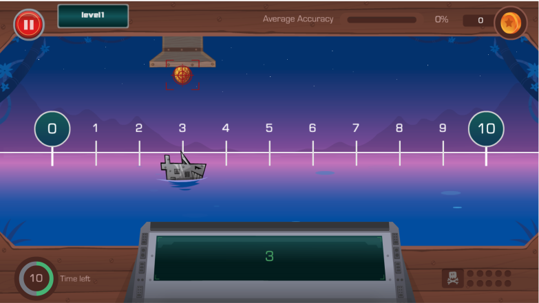
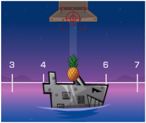
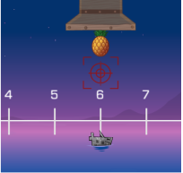

# Example 2: An Online Math Game

### Battleship Numberline



Battleship Numberline is an educational game that helps students improve their understanding of number line estimation. The game is simple: students estimate the position of a robot pirate ship on the number line and try to destroy it. If they can estimate the position of the ship correctly, a falling pineapple will explode the ship! If they estimate the location of the ship incorrectly, the pineapple will fall in the water.

Although we are giving the integration example using a game, UpGrade can be integrated with any kind of educational software.

**We are going to use the JavaScript client library in this example.**

### Experiments

We will assume that we are running two experiments in UpGrade:

1. **Time Limit**: Controlling the time students are given to answer the question. This experiment has 3 conditions:
   1. 10 seconds
   2. 20 seconds
   3. 30 seconds
2. **Ship Size**: Controlling the length of the ship and making it easy or hard for students to hit the targets. Each condition defines the length of the ship as a percentage of the number line. This experiment has 4 conditions:
   1. 5%&#x20;
   2. 10%
   3. 20%
   4. 30%

Here is an example of what different ship sizes look like (the first one is 20%, the second one is 5%):





Now that we have defined our experiments for the game, let us see how we can get the condition assignments for these experiments in the game code.

### Installation

We will start by installing the UpGrade client library into our project. To use the client library in your JS project, you can use the following command to install the package:

`npm install upgrade_client_lib`

### Import

**Note:** You can refer the following gist for Upgrade Integration: [`https://gist.github.com/JD2455/819b178bd43fc3da376eb2d6ddc55c3b`](https://gist.github.com/JD2455/819b178bd43fc3da376eb2d6ddc55c3b)

Once installed, you will be able to import the library to the file you want to use it in.

`import { UpgradeClient } from "upgrade_client_lib";`

After the import, you will need to set the Host URL of your UpGrade Service and pass it to the UpgradeClient with UserID. Here, the host-URL is the end-point of the server you hosted in part-1 of this article.

For e.g.:&#x20;

```javascript
const hostUrl = 'http://development-upgrade-experiment-app.eba-gp6psjut.us-east-1.elasticbeanstalk.com';
```

You can make a new instance of the UpGrade client. You have to provide a User ID and hostUrl to the UpGrade client, based on which UpGrade will do condition assignments for different experiments. You cannot omit the User ID and hostUrl. Two ways for initializing user:

```javascript
const upgradeClient = new UpgradeClient(userID, hostUrl);
const upgradeClient = new UpgradeClient(userID, hostUrl, token);
```

Once a user is assigned to a condition, the user will keep getting the same condition for the experiment until the experiment ends. At the end, the user will get the condition defined as per the post experiment rule.

### Getting Experiments

To get the experiment assignments for a given user, you have to call the `getAllExperimentConditions` method. You can pass a context for which you want the experiments. The context is set for each experiment when it is created.

This function call is an asynchronous call that returns a promise. You can either use `await` or `.then` construct to wait on the call to complete.

```jsx
const context = "app";
const upExperiments = await this.upgradeClient.getAllExperimentConditions(context);
```

`getAllExperimentConditions` will return an array of all the experiments in the following`IExperimentAssignment` format:

```jsx
interface IExperimentAssignment {
    expId: string;
    expPoint: string;
    twoCharacterId: string;
    description: string;
    assignedCondition: {
        conditionCode: string;
        twoCharacterId: string;
        description: string;
    };
}
```

The `assignedCondtion` condition object will have the condition assignment for the user.

### Using Experimental Assignments

Once you receive the experimental assignments, you can use them whenever you want.

**A very typical way to use the condition assignments it to use them in an if/else or case/when block.** You can check the value of `assignedCondition.conditionCode` and based on its value, give the user a unique experience.

> A very important point: If you find that `assignedCondition.conditionCode` has an invalid value, please ensure that your code has a fallback value. We call this the **default** value. **default** is a reserved keyword in the UpGrade system. UpGrade can also send default as the condition assignment, which means that the user should get the fallback condition.

Once you use the condition value to give the user the appropriate experience, let the UpGrade server know that you have shown user the condition using the `markExperimentPoint` function.



```jsx
private setTimeLimit(condition) {

    // Example for the Time Limit experiment
    switch (condition) {

        case "10":
            // Set the time limit to 10 seconds
            GameManager.setTimeLimit(10);
            markExperimentPoint("setTimeLimit");
            break;

        case "20":
            // ...
            GameManager.setTimeLimit(20);
            markExperimentPoint("setTimeLimit");
            break;

        case "default":
            // This is the fallback condition
            // do not put the break; statement here
        default:
            // Define your fallback behavior here
            // Example: Set the time limit to 10 seconds
            GameManager.setTimeLimit(10);
            // Note here that we are not doing the markExperimentPoint call
            break;

        }

}

setTimeLimit(assignedCondition.conditionCode);
```



```java
```



### Posting the Analytics

You can post analytics of the student learning to UpGrade. These analytics can help researchers determine which experimental condition is working better. You can post metrics such as time spent, accuracy, number of errors, etc.

The client library provides a `log` function to post the analytics. This function expects an array of the metrics that you want to post.

```javascript
async log(value: ILogInput[], sendAsAnalytics = false): Promise<Interfaces.ILog[]>;

export interface ILogInput {
    timestamp: string;
    metrics: ILogMetrics;
}
```

To post the analytics, simply call the `log` function as per your need:

```javascript
// Normal scenario
upgradeClient.log(metrics);

// If you want to wait on the response form the host
await upgradeClient.log(metrics);

// In case of posting analytics on the unload call, use the following
upgradeClient.log(metrics, true);
```

Once the metrics are posted, they become available in the experiment UI in the web application. Researchers can use them to decide which condition is working best.
