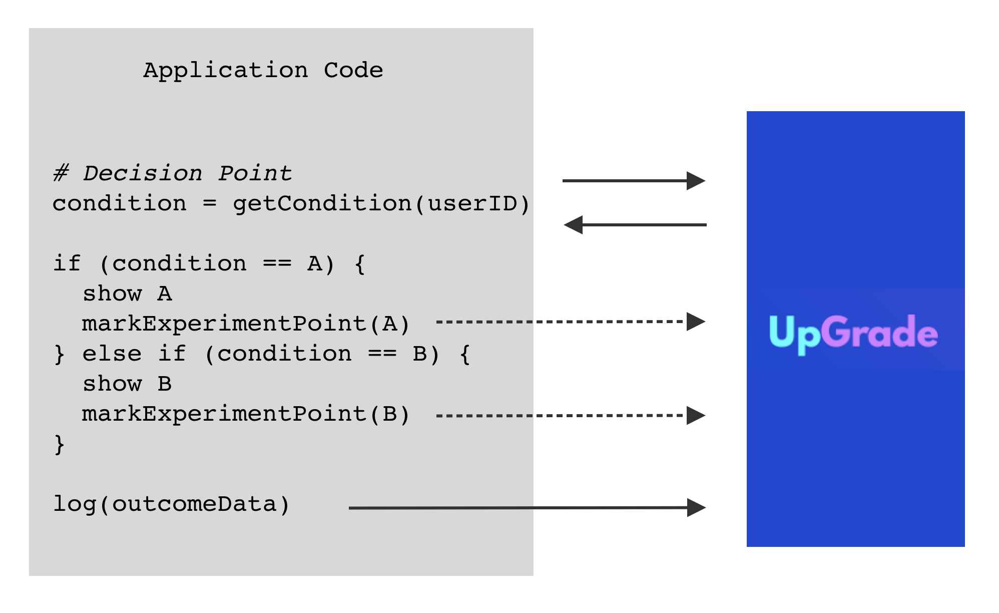

# How UpGrade Works

The diagram below gives a highly simplified overview of how UpGrade interacts with an EdTech application:



**Here is the key idea**: Every place in the code where we can randomly show learning experiences to the users becomes a decision point. At this decision point, we send the user's ID and ask it to assign a condition to that user ID. Based on the condition returned by UpGrade, we can give the appropriate experience to the user.

Once the user has seen version A or B of a learning experience, we can let the UpGrade know that they have seen it by calling a markExperimentPoint routine.

UpGrade also tracks the outcome metrics of users and lets us analyze these metrics for users in different conditions. We can periodically send the user's log data to UpGrade by calling the log function.

```
// Some code
```
